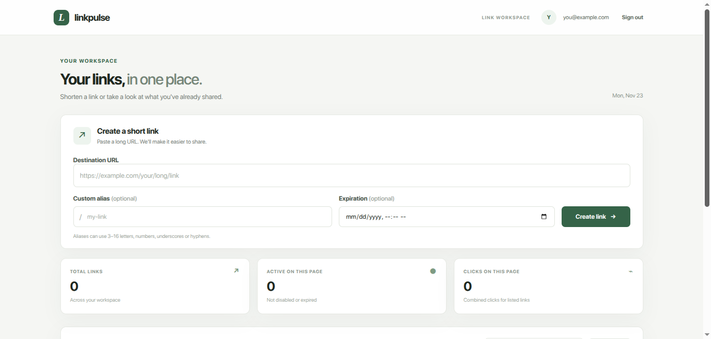
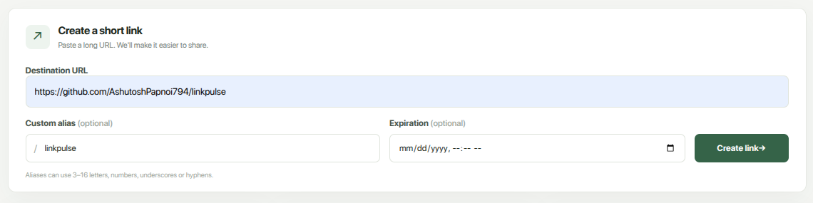
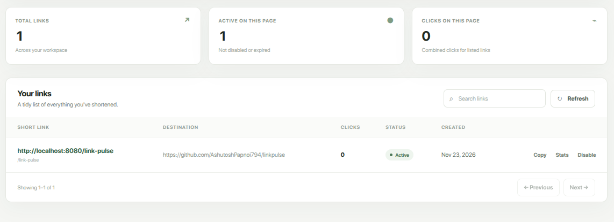
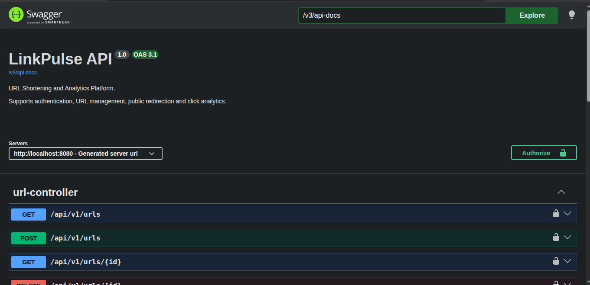
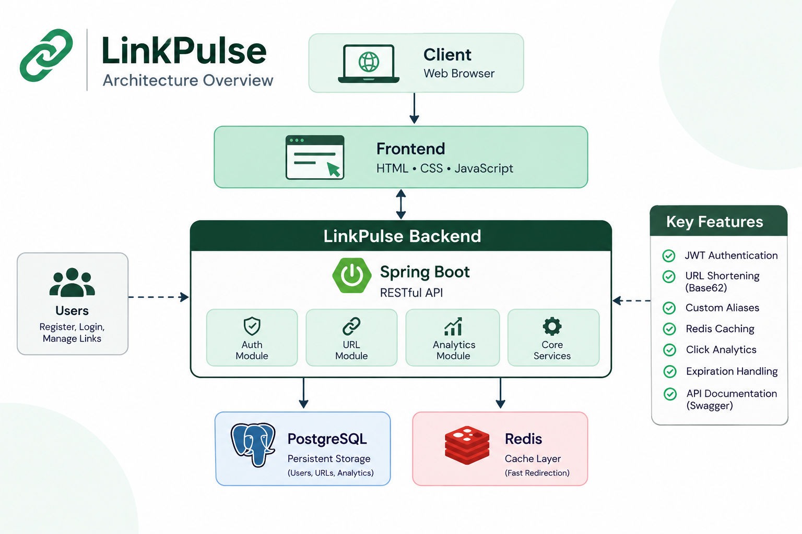

# LinkPulse

### URL Shortening & Analytics Platform

LinkPulse is a RESTful URL shortening platform built using Java and Spring Boot. It allows authenticated users to create, manage, and track shortened URLs, with Redis caching for efficient redirection and PostgreSQL for persistent storage.

## Features

- **User authentication:** Registration and login using Spring Security and JWT.
- **URL shortening:** Generate unique random Base62 short codes.
- **Custom aliases:** Create personalized short URLs with collision handling.
- **URL management:** Retrieve, update expiration settings, and deactivate shortened URLs.
- **Ownership protection:** Users can access and manage only their own URLs.
- **Fast redirection:** Redis cache-aside strategy with PostgreSQL fallback.
- **Click analytics:** Transactional click tracking and daily click aggregation.
- **Expiration handling:** Automatically reject expired shortened URLs.
- **API documentation:** Interactive Swagger UI documentation.
- **Containerization:** Run the application, PostgreSQL, and Redis using Docker Compose.

## Screenshots

### Dashboard

<p align="center">
  
</p>

Overview of shortened links, click statistics, and link management.

### Create a short link

<p align="center">
  
</p>

Create shortened URLs with optional custom aliases and expiration dates.

### Analytics

<p align="center">
  
</p>

Monitor click activity and daily engagement for individual shortened URLs.

### API documentation

<p align="center">
  
</p>

Explore and test REST endpoints through the interactive OpenAPI documentation.

## Technology Stack

| Category | Technologies |
|---|---|
| Language | Java 21 |
| Backend | Spring Boot 4.1.2, Spring MVC |
| Security | Spring Security, JWT, BCrypt |
| Database | PostgreSQL 16 |
| ORM | Spring Data JPA, Hibernate |
| Caching | Redis 7, Spring Data Redis |
| Migrations | Flyway |
| API Documentation | OpenAPI, Springdoc |
| Testing | JUnit 5, Mockito, Spring Boot Test, MockMvc |
| Build | Maven |
| DevOps | Docker, Docker Compose, GitHub Actions |

## Architecture

LinkPulse follows a modular monolithic architecture built
with Spring Boot, PostgreSQL and Redis.

<p align="center">
  
</p>

### URL Redirection Flow

1. A visitor requests a shortened URL.
2. The application checks Redis for the short code.
3. On a cache miss, PostgreSQL is queried.
4. The application verifies that the URL is active and has not expired.
5. The click is recorded and the total click counter is incremented transactionally.
6. The application returns an HTTP 302 redirect to the original URL.

PostgreSQL remains the source of truth, while Redis is used as a cache.

## API Endpoints

### Authentication

| Method | Endpoint | Description |
|---|---|---|
| POST | `/api/v1/auth/register` | Register an account |
| POST | `/api/v1/auth/login` | Authenticate and receive a JWT |
| GET | `/api/v1/auth/me` | Retrieve authenticated user information |

### URL Management

All URL management endpoints require a valid JWT Bearer token.

| Method | Endpoint | Description |
|---|---|---|
| POST | `/api/v1/urls` | Create a shortened URL |
| GET | `/api/v1/urls` | List user's URLs with pagination |
| GET | `/api/v1/urls/{id}` | Retrieve a URL |
| PATCH | `/api/v1/urls/{id}` | Update expiration |
| DELETE | `/api/v1/urls/{id}` | Deactivate a URL |

### Redirection and Analytics

| Method | Endpoint | Description |
|---|---|---|
| GET | `/{shortCode}` | Public URL redirection |
| GET | `/api/v1/urls/{id}/analytics` | Retrieve click analytics |

## Getting Started

### Prerequisites

- Git
- Docker
- Docker Compose v2

Java and Maven do not need to be installed separately when running the complete application through Docker Compose.

### 1. Clone the repository

```bash
git clone https://github.com/YOUR_USERNAME/linkpulse.git
cd linkpulse
```

### 2. Configure environment variables

Create your local environment file:

```bash
cp .env.example .env
```

Generate a JWT signing secret:

```bash
openssl rand -base64 32
```

Open `.env` and configure:

```env
POSTGRES_DB=linkpulse
POSTGRES_USER=linkpulse
POSTGRES_PASSWORD=your_local_database_password

JWT_SECRET_BASE64=your_generated_base64_secret

APP_BASE_URL=http://localhost:8080
```

Never commit `.env` or expose your real JWT signing secret.

### 3. Start the complete application

```bash
docker compose up --build -d
```

This starts:

- LinkPulse Spring Boot application
- PostgreSQL database
- Redis cache

Check service status:

```bash
docker compose ps
```

### 4. Verify the application

Health endpoint:

```text
http://localhost:8080/actuator/health
```

Interactive API documentation:

```text
http://localhost:8080/swagger-ui/index.html
```

The backend is now ready to accept requests.

### 5. Stop the application

```bash
docker compose down
```

Database data is stored in a persistent Docker volume and survives ordinary container removal.

To delete the development database volume as well:

```bash
docker compose down -v
```

**Warning:** The latter command permanently deletes the local database data.

## Running Tests

For local integration tests, start PostgreSQL and Redis using Docker Compose:

```bash
docker compose up -d postgres redis
```

Load local environment variables:

```bash
set -a
source .env
set +a
```

Run the complete Maven test suite:

```bash
./mvnw clean verify
```

The integration tests exercise authentication, URL management, ownership, redirection, caching, and analytics.

GitHub Actions also runs the build and tests using temporary PostgreSQL and Redis service containers on pushes and pull requests to `main`.

## Engineering Decisions

### Random Base62 Short Codes

Short codes use a cryptographically secure random generator and a 62-character alphabet.

Database uniqueness constraints remain the final protection against collisions. Failed insertion attempts are retried in separate transactions.

### Redis Cache-Aside Strategy

The application checks Redis before querying PostgreSQL. Cache entries have a configured expiration time and are invalidated following URL updates and deactivation.

PostgreSQL remains authoritative if Redis is unavailable.

### Transactional Click Tracking

Each successful redirect records an individual click event and atomically increments the URL's click counter within a database transaction.

### Resource Ownership

URL management and analytics queries include the authenticated user's database ID, preventing users from accessing other accounts' resources.

### Database Migrations

Flyway manages schema changes through version-controlled SQL migrations. Hibernate validates entity mappings rather than automatically modifying the schema.

## Project Structure

```text
linkpulse/
├── src/
│   ├── main/
│   │   ├── java/com/linkpulse/
│   │   │   ├── auth/
│   │   │   ├── url/
│   │   │   ├── analytics/
│   │   │   ├── security/
│   │   │   ├── common/
│   │   │   └── config/
│   │   └── resources/
│   │       ├── db/migration/
│   │       └── application.yaml
│   └── test/
├── .github/workflows/
│   └── ci.yml
├── Dockerfile
├── compose.yaml
├── pom.xml
├── .env.example
└── README.md
```

## Future Improvements

- Refresh token and token revocation support.
- Asynchronous analytics using Kafka.
- Rate limiting for public redirection.
- More detailed analytics and reporting.
- Distributed deployment and horizontal scaling.

## License

This project is licensed under the MIT License.
